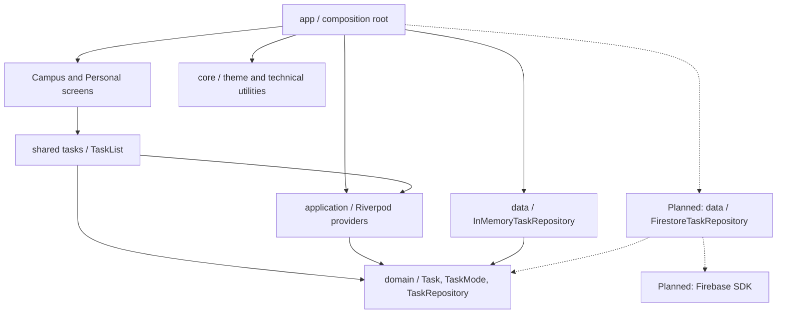

# Tarteeb architecture

Feature-first organization with four layers inside each feature: presentation,
application (Riverpod state), domain, and data. The starter implements a read-only
task slice to demonstrate the boundaries. Add other layers when a feature needs
them; do not create empty controller/service abstractions.

## Project map

All paths below are relative to `TheCode/`, the Flutter project root. The
`android/`, `ios/`, and `web/` folders beside `lib/` host the platform runners;
all three use the same feature code. Run Flutter commands inside `TheCode/`.

```text
lib/
  main.dart                         # Calls the composition root
  app/
    bootstrap.dart                  # Selects repositories through overrides
    demo_tasks.dart                 # Fictional startup fixtures
    tarteeb_app.dart                 # MaterialApp
    home_screen.dart                # Mode navigation / app composition
  core/
    theme/app_theme.dart            # Feature-independent UI foundation
  features/
    shared/
      tasks/
        presentation/task_list.dart # One UI for both modes and all async states
        application/task_providers.dart
        domain/                     # Task, TaskMode, TaskRepository
        data/in_memory_task_repository.dart
    campus/presentation/campus_screen.dart
    personal/presentation/personal_screen.dart
test/                               # Mirrors the feature layout; app + boundary tests
docs/adr/                           # Architecture decisions
```

Campus and Personal are feature groups under `features/`. Future capabilities
belong in `features/campus/courses/{presentation,application,domain,data}` or
`features/personal/habits/{presentation,application,domain,data}`. Shared product
capabilities such as tasks belong in `features/shared/`, not in `core/`.

## Dependency diagram

Arrows mean source dependency, not runtime response direction. Dashed nodes/edges
describe the planned Firebase integration, which is not enabled in this starter.



## Dependency rules

| Layer | May depend on | Must not depend on |
| --- | --- | --- |
| `app` | All layers for composition, routes and bootstrap | Business rules duplicated from features |
| `core` | Dart, Flutter, technical libraries | `features`, `app`, product-specific models |
| `presentation` | Application providers, domain values, core UI | Repository implementations, Firebase SDK |
| `application` | Riverpod, domain contracts/rules, non-UI core | Widgets, presentation, data implementations |
| `domain` | Dart and domain types | Flutter, Riverpod, Firebase, serialization DTOs |
| `data` | Domain contracts, SDKs, technical core | Widgets, application providers |

Campus and Personal may depend on shared features but never on each other.
Shared features never import either mode. Features never import `app`.
`test/architecture/dependency_rules_test.dart` guards the current source imports.
Review new conditional imports and code generation explicitly if introduced;
the lightweight guard is not a full Dart dependency analyzer.

## State and shared task ownership

`TaskRepository` owns the read contract. The in-memory adapter snapshots its input,
filters by mode and returns immutable lists. Both screens invoke the same
`TaskList(mode: ...)` and `tasksProvider(mode)` family. Mode is a query parameter,
not a reason to clone task models, providers, repositories, or widgets.

Riverpod owns asynchronous loading state and dependency injection. The app shell's
navigation index is ephemeral widget state. Providers are automatically disposed
when their mode is no longer watched; stale results cannot populate another mode.
`AsyncValue` distinguishes loading, data (including an empty list), and failure.
Retry invalidates just the current mode's provider and displays loading again.
Raw exceptions and private backend details are never rendered to the user.

Future mutations belong in shared application controllers using `AsyncNotifier`
when they need state. Keep validation and planning rules in pure domain code;
introduce a use-case class only for reusable or multi-repository business logic.
Do not add pass-through use cases to every read.

## Firebase repository integration (follow-up)

Add `features/shared/tasks/data/firestore_task_repository.dart` implementing the
same `TaskRepository`. Keep document parsing/DTOs in `data/`; convert timestamps,
document IDs and SDK exceptions there, exposing only domain values and typed
failures. Do not pass snapshots or Firebase exceptions through widgets.

`app/bootstrap.dart` will initialize Firebase and override `taskRepositoryProvider`
with the adapter. Inject the initialized client and authenticated user context;
do not create Firebase singletons in widgets. Bind repository lifetime to the
authenticated session, invalidate task state on sign-out/account change, and
enforce ownership through Firestore security rules as well as query scope.
Mode filtering is not an authorization boundary.

Firebase setup, Auth, schema/index design, rules/emulator tests and production
configuration remain separate backlog tasks (004, 014, 015). This starter does
not claim persistent storage or live synchronization. When those arrive, contract
tests must run against both adapters; SDK behavior needs emulator tests.

## Naming conventions

- Files/folders: `snake_case`; types/enums: `UpperCamelCase`; members/providers:
  `lowerCamelCase`. Provider variables end in `Provider`.
- Screens: `CampusScreen` in `campus_screen.dart`; reusable widgets: `TaskList`.
- Domain contracts: `TaskRepository`; adapters: `InMemoryTaskRepository`, later
  `FirestoreTaskRepository`; domain models: `Task` (no SDK suffixes).
- Stateful application coordinators: `TaskController`; reusable business actions:
  a verb such as `ScheduleTask`. Introduce them only when behavior warrants it.
- Tests end in `_test.dart` and follow `lib/` structure. Use relative imports in
  `lib/`, package imports in tests; avoid barrel files that hide layer crossings.

## References

- [Flutter architecture guidance](https://docs.flutter.dev/app-architecture/guide)
  informs the separation of UI state and repository responsibilities.
- [Riverpod overrides](https://riverpod.dev/docs/concepts2/overrides) supply the
  repository injection mechanism used by bootstrap and tests.
- [Firebase Flutter setup](https://firebase.google.com/docs/flutter/setup) documents
  the future environment-specific initialization workflow.

See [ADR 0001](adr/0001-feature-first-layered-architecture.md) for alternatives and
[verification](verification.md) for validation and remaining device checks.
